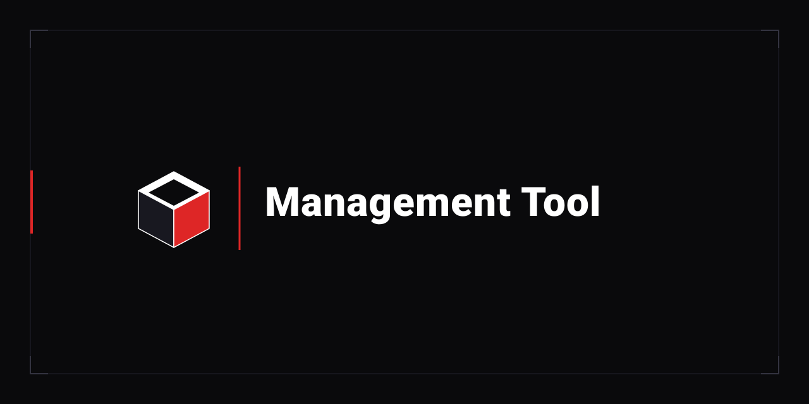

<div align="center">
  
</div>

# Management Tool Suite [Unified Router & Subsystem Hub]

> **Author**: Elton Boehnen · boehnenelton2024@gmail.com · [boehnenelton2024.pages.dev](https://boehnenelton2024.pages.dev) · [GitHub](https://github.com/boehnenelton)  
> **Format**: BEJSON 104a / 105 Standards & MFDB v1.31 Zero-SQL Data Engine  
> **Interface**: 57-Column Portrait Terminal Discipline · Policy §8.1 Truecolor (#DE2626)  
> **Platform**: Linux / Android Termux (ARM64) Portable Runtime  

---

## 1. Architectural Overview

The **Management Tool Suite** provides an authoritative, zero-SQL unified operational interface for system administration, structured logging, technical report indexing, and categorized knowledge base management across three dedicated operational modes:

```
                      ┌────────────────────────────────────────┐
                      │   management_tool.py (management.sh)   │
                      │         [UNIFIED MASTER ROUTER]        │
                      └───────────────────┬────────────────────┘
                                          │
         ┌────────────────────────────────┼────────────────────────────────┐
         │                                │                                │
         ▼                                ▼                                ▼
  ┌───────────────┐              ┌──────────────────┐             ┌─────────────────┐
  │    Mode 1     │              │      Mode 2      │             │     Mode 3      │
  │ Logging Tool  │              │  Report Indexer  │             │   Notes Tool    │
  │ (logging_tool)│              │ (report_indexer) │             │  (notes_tool)   │
  └───────┬───────┘              └────────┬─────────┘             └────────┬────────┘
          │                               │                                │
          ▼                               ▼                                ▼
  • BEJSON 105 Log Sink           • Research Papers Index         • Dedicated MFDB v1.31
  • Loaded Chamber Context        • Category Management           • Loaded Chamber State
  • Single-Page HTML Reports      • Search & Query                • Tag Management
    via md2html                   • Markdown Pull / View          • Strict Markdown Export
  • Global Audit & Rotation                                       • Static Taxonomy Site
```

---

## 2. Subsystems & Modes

### Mode 1: Stateful Global Logging Tool (`logging_tool.py`)
- **Persistence**: Daily UTC partitions under `$GLOBAL_LOGS/Log-<YYYY-MM-DD>.bejson` and dual-path encrypted secure sinks (`$GLOBAL_LOGS_SECURE/Log-<YYYY-MM-DD>-secure.bejson`).
- **Loaded Chamber Pattern**: Lock session metadata (`subsystem`, `category`, `actor`, `session_id`) into persistent state once, emitting subsequent logs with zero argument friction.
- **Single-Page HTML & Markdown Reports**: Output log streams from schema into structured templated Markdown and convert into standalone HTML reports with BECSS Tri-Color styling via `md2html`.
- **Integrity Gates**: Structural validation, SHA-256 hash chaining, checksum verification, and automated rotation.

### Mode 2: Research Reports Indexer (`report_indexer.py`)
- **Persistence**: Central index table (`data/reports_index.bejson`) backed by BEJSON 104a.
- **Workflow**: Catalog, categorize, import, pull, view, and search technical specifications, audit papers, and research documents.

### Mode 3: Categorized Notes Manager (`notes_tool.py`)
- **Persistence**: Dedicated Multi-File Database (MFDB v1.31) with central manifest (`data/mfdb/104a.mfdb.bejson`) coordinating child entity tables (`category.bejson`, `note.bejson`) linked via `Parent_Hierarchy`.
- **Loaded Chamber Pattern**: Lock active category and active note persistently in `config/state.json`. Commands (`--view`, `--export`, `--add-tag`, `--remove-tag`, `--set-category`, `--note-delete`) execute against the loaded note without repeating identifiers.
- **Strict Markdown Header Specification**: Exported notes strictly prepend metadata headers:
  ```markdown
  #tag1 #tag2 #tag3
  # Note Title
  # Category Name

  Note body content here...
  ```
- **Markdown Ingestion**: Ingests external `.md` files, parsing hashtags, title, and category headers into MFDB records automatically.
- **Static Documentation Site Generator**: Compiles entire notes database into clean SEO domain/taxonomy website hierarchy:
  - Layout: `notes/<category>/<note-slug>/index.html` + `<note-slug>.md`
  - Category Feeds: `<category>/index.html` and `feed.html` with instant live search
  - Master Portal Hub: `index.html`
  - Accessible Sitemaps: `sitemap.html`, `sitemap.xml`, and `robots.txt`
  - Zero External Dependencies: Embedded responsive dark theme (`#05070B`, `#0B0F17`, `#DE2626`), Open Graph, Schema.org JSON-LD, and ARIA landmark accessibility.
- **CLI Configuration Management**: Inspect and edit site parameters, author profiles, and build flags via `--config` and `--config-set <key> <val>`.

---

## 3. CLI Command Guide

### Master Router Operations

```bash
# Display unified chamber status across all subsystems
./management.sh --status

# Select active operational mode (1, 2, or 3)
./management.sh --select-mode logging    # Mode 1
./management.sh --select-mode reports    # Mode 2
./management.sh --select-mode notes      # Mode 3

# Direct Subsystem Execution
./management.sh log [arguments...]      # Route to logging_tool
./management.sh report [arguments...]   # Route to report_indexer
./management.sh note [arguments...]     # Route to notes_tool
```

### Logging & Report Generation (Mode 1)

```bash
# Write structured log entry
./management.sh log write -m "Completed refactor" -l "INFO" -k "app.update" -s "Core"

# Lock chamber context
./management.sh log context --set-subsystem "BEJSON_CMS" --set-category "feature"

# Query daily logs
./management.sh log read --min-level WARN --limit 20

# Compile Single-Page HTML Report via md2html
./management.sh log report --limit 50 --theme dark
./management.sh log report --subsystem Core --md-out exports/core_report.md
```

### Categorized Notes Management (Mode 3)

```bash
# Category Management
./notes.sh --list-categories
./notes.sh --category-create "Architecture" --desc "System specifications"
./notes.sh --select-category "Architecture"

# Note Management
./notes.sh --note-new -t "MFDB Core Spec" -c "Manifests use 104a format." --tags "mfdb,spec"
./notes.sh --select-note "MFDB Core Spec"
./notes.sh --add-tag "v131"
./notes.sh --set-category "General"

# Export Markdown (#tag1 #tag2\n# title\n# category\n\ncontent)
./notes.sh --export

# Search across notes
./notes.sh --query "manifest"

# Compile Static Taxonomy Documentation Website
./notes.sh --export-site
./notes.sh --config-set site_title "Technical Knowledge Base"
./notes.sh --config
```

---

## 4. Repository Structure

```
management_tool/
├── management_tool.py        # Master Router Entry Point
├── management.sh             # Master Shell Launcher
├── logging_tool.py           # Mode 1: Stateful Global Logging Tool
├── report_indexer.py         # Mode 2: Research Reports Indexer
├── notes_tool.py             # Mode 3: Categorized Notes MFDB Manager
├── notes.sh                  # Mode 3 Shell Launcher
├── bejson_project.json       # Project Identity & Version Descriptor
├── .gitignore                # Excludes runtime data, logs, notes, and reports
├── config/
│   └── config.json           # Default System Configuration Store
├── lib/
│   ├── lib_log_report_generator.py # Markdown & HTML Report Generator
│   ├── lib_md_to_html.py           # Markdown-to-HTML Parsing Engine
│   ├── templates/                  # BECSS Tri-Color HTML Templates
│   ├── notes_mfdb_engine.py        # Notes MFDB Engine & Chamber Machine
│   ├── notes_site_exporter.py      # Static Documentation Site Generator
│   ├── lib_bejson_Core_*           # BEJSON Core Primitives & Parsing
│   └── lib_bejson_Standards_*      # BEJSON 105 Standards Logging Engine
└── README.md                 # Technical Documentation & Manual
```

---

## 5. License & Credits

Authored by **Elton Boehnen** (`boehnenelton2024@gmail.com`).  
Licensed under the **MIT License** and built for the **BEJSON 104a / 105 Standards** ecosystem.
