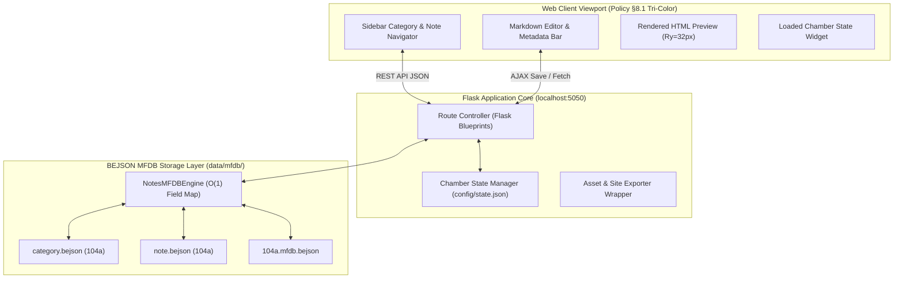

# Flask Notes Editor — Architecture, Taxonomy & Interface Specification
**Document ID**: `DEV-SPEC-NOTES-FLASK-001`  
**Ecosystem**: Unified Management Tool Suite (`~/staging/management_tool/`)  
**Target Subsystem**: Notes Management Engine (`notes_mfdb_engine.py` / `notes_tool.py`)  
**Standards Compliance**: BEJSON 104a / MFDB v1.31 / Policy §6.1, §6.2, §8.1–§8.7, §9.1–§9.2, §10.1–§10.4  
**Author**: Elton Boehnen · boehnenelton2024@gmail.com · boehnenelton2024.pages.dev · github.com/boehnenelton  
**Date**: 2026-11-05  

---

## 1. Executive Summary & Architectural Vision

The **Flask Notes Editor** is a lightweight, zero-cloud, zero-SQL web application that wraps the high-density BEJSON MFDB Notes Engine ([`notes_mfdb_engine.py`](file:///storage/emulated/0/Admin/System/tools/management_tool/lib/notes_mfdb_engine.py)). It exposes an ergonomic, responsive desktop and mobile interface running natively on Android Termux (via localhost loopback), bridging the CLI Loaded Chamber pattern to an interactive browser workspace.



---

## 2. Canonical Entity Taxonomy (Policy §10.1 – §10.4)

All entities in the web wrapper adhere to snake_case entity-prefixed column names, immutable primary keys, and explicit foreign key constraints:

### 2.1 Entity: `NoteCategory` (`cat_*`)
* **Storage Location**: `data/mfdb/data/category.bejson`
* **Owning Write Module**: `notes_mfdb_engine.py`
* **Schema Contract**:
  | Field Name | Type | Key | Description |
  | :--- | :--- | :--- | :--- |
  | `cat_id` | `string` | **PK** | Immutable unique identifier (`cat_001`, `cat_002`) |
  | `cat_name` | `string` | — | Display label (e.g. `Architecture`, `Transcripts`) |
  | `cat_slug` | `string` | — | URL-safe and filesystem-safe slug (e.g. `architecture`) |
  | `cat_description` | `string` | — | Scope description of the category |
  | `cat_note_count` | `integer`| — | O(1) cached count of active child notes |
  | `cat_created_at` | `string` | — | UTC ISO-8601 creation timestamp |
  | `cat_updated_at` | `string` | — | UTC ISO-8601 modification timestamp |

### 2.2 Entity: `NoteRecord` (`note_*`)
* **Storage Location**: `data/mfdb/data/note.bejson`
* **Owning Write Module**: `notes_mfdb_engine.py`
* **Schema Contract**:
  | Field Name | Type | Key | Description |
  | :--- | :--- | :--- | :--- |
  | `note_id` | `string` | **PK** | Immutable unique identifier (`not_001`, `not_023`) |
  | `cat_id` | `string` | **FK** | Parent category reference (`cat_fk` cascade on delete) |
  | `note_title` | `string` | — | Note headline or research topic |
  | `note_slug` | `string` | — | URL-safe slug |
  | `note_content_markdown` | `string` | — | Raw Markdown source text |
  | `note_tags_collection` | `array` | — | List of hashtag labels (`["bejson", "architecture"]`) |
  | `note_word_count_metric`| `integer`| — | Word count calculation metric |
  | `note_reading_time_mins`| `integer`| — | Estimated read time (200 wpm baseline) |
  | `note_created_at` | `string` | — | UTC ISO-8601 timestamp |
  | `note_updated_at` | `string` | — | UTC ISO-8601 timestamp |
  | `note_relational_uuid` | `string` | — | Generated RFC 4122 v4 recency fingerprint |

### 2.3 Entity: `WebChamberSessionState` (`chamber_*`)
* **Storage Location**: `config/state.json` (synchronized across CLI and Web)
* **Schema Contract**:
  | Field Name | Type | Description |
  | :--- | :--- | :--- |
  | `chamber_active_mode` | `string` | Fixed to `"notes"` during editor session |
  | `chamber_active_category_id` | `string` | Currently locked category ID or `null` (all) |
  | `chamber_active_note_id` | `string` | Currently locked note ID in active chamber |
  | `chamber_is_dirty_flag` | `boolean` | Unsaved in-memory changes flag |
  | `chamber_last_synced_at` | `string` | UTC ISO-8601 sync timestamp |

---

## 3. Self-Describing Variable Standard (Policy §6.1)

Per the **Hierarchy-Group-Purpose Triad** (`<hierarchy_or_scope>_<group_or_domain>_<purpose_or_role>`), single-letter variables (`i`, `j`, `e`, `x`) and cryptic abbreviations (`req`, `res`, `tmp`, `val`, `doc`) are strictly prohibited across Python routes, backend engines, and frontend JavaScript.

```carousel
```python
# Backend Python Variables (Hierarchy-Group-Purpose Triad)
session_chamber_active_note_identifier: str = "not_002"
request_category_filter_parameter: Optional[str] = None
database_category_record_collection: List[Dict[str, Any]] = []
database_note_field_map_cache: Dict[str, int] = {}
payload_sanitized_markdown_content: str = ""
response_json_payload_dictionary: Dict[str, Any] = {}
server_listening_port_constant: int = 5050
```
<!-- slide -->
```javascript
// Frontend JavaScript Variables (DOM & State Management)
const dom_sidebar_category_select_element = document.getElementById("select-category-filter");
const dom_editor_title_input_element = document.getElementById("input-note-title");
const dom_editor_content_textarea_element = document.getElementById("textarea-note-markdown");
const dom_preview_render_container_element = document.getElementById("container-markdown-preview");
const state_active_loaded_note_identifier = "not_002";
const metric_document_total_word_count = 1420;
let debounce_autosave_timer_handle = null;
```
<!-- slide -->
```html
<!-- DOM Element IDs (Explicit Hierarchy & Component Role) -->
<header id="header-global-navigation-bar">
  <button id="button-sidebar-navigation-toggle"></button>
  <span id="badge-chamber-status-indicator"></span>
</header>
<main id="main-editor-split-workspace">
  <textarea id="textarea-markdown-source-editor"></textarea>
  <div id="container-rendered-html-preview"></div>
</main>
```
````

---

## 4. Visual Branding & Spatial Layout (Policy §8.1 – §8.4)

### 4.1 Tri-Color Visual Tokens
* **Background Primary**: `#FFFFFF` (Light Mode) or `#000000` (Dark Mode)
* **Text Primary**: `#000000` (Light Mode) or `#FFFFFF` (Dark Mode)
* **Accent Primary**: `#DE2626` (Red — Truecolor brand invariant)
* **Border & Dividers**: `1px solid #DE2626` (Accent) or `1px solid rgba(222, 38, 38, 0.2)`
* **Typography**: Monospace (`Fira Code`, `JetBrains Mono`, `monospace`) for editor and metrics; Sans-serif system font for navigation.

### 4.2 Brand Imagery: The MFDB Cube Taxonomy (Policy §8.3e)
The header brand incorporates the **MFDB Satellite Cube Icon**: a central solid red cube `#DE2626` connected via sharp rectilinear axis lines to four orbiting satellite cubes representing the decoupled entity tables (`category`, `note`, `tag`, `state`).

```
      ┌───┐
      │ 4 │
      └─┬─┘
        │
┌───┐ ┌─┴─┐ ┌───┐
│ 1 ├─┤ M ├─┤ 2 │   <-- MFDB v1.31 Spatial Brand Identity
└───┘ └─┬─┘ └───┘
        │
      ┌─┴─┐
      │ 3 │
      └───┘
```

---

## 5. Interface Sections & UI Component Hierarchy

The UI employs **Feature Isolation** (§8.4c): clean modular containers without deep modal nesting.

```
+-----------------------------------------------------------------------+
| [M] BEJSON NOTES WEB  | Chamber: [not_002 Locked] | [Save] [New] [X] |
+------------------------------------+----------------------------------+
| CATEGORIES & NOTES                 | NOTE EDITOR (not_002)            |
| Search: [___________________]      | Title: [BEJSON 104a Core Spec__] |
|                                    | Category: [Architecture v]       |
| • Architecture (1)                 | Tags: [#spec #core #bejson]      |
|   ↳ [*] BEJSON 104a Core Spec      +----------------------------------+
| • Transcripts (20)                 | RAW MARKDOWN   | LIVE PREVIEW    |
| • General (1)                      | # Header       | # Header        |
| • Specs (1)                        | Text content.. | Text content..  |
|                                    |                |                 |
|                                    | Words: 512     | Status: Synced  |
+------------------------------------+----------------+-----------------+
| Server: 127.0.0.1:5050 | Elton Boehnen | RELATIONAL_ID: 79c10cd0-...  |
+-----------------------------------------------------------------------+
```

### 5.1 Section 1: Header Toolbar (`#header-global-toolbar`)
1. **Brand Capsule**: SVG MFDB Cube icon + `"BEJSON NOTES [Notes Editor]"`
2. **Active Note Badge** (`#badge-active-note-status`):
   * `[Active: not_002]` with pulsating `#DE2626` dot when dirty/unsaved.
3. **Quick Action Group**:
   * `#button-action-new-note`: Opens blank template.
   * `#button-action-save-note`: Flushes buffer to MFDB.
   * `#button-action-export-html`: Calls static site exporter.
   * `#button-action-toggle-preview`: Switches split/single pane on mobile.

### 5.2 Section 2: Sidebar Navigator (`#sidebar-notes-navigator`)
1. **Search & Tag Filter Bar** (`#input-search-query-filter`)
2. **Category Accordion List** (`#container-category-list`):
   * Category pill buttons showing `cat_name` and `cat_note_count`.
3. **Note Card Stream** (`#container-note-card-stream`):
   * Cards with title, updated timestamp, word count pill, tag chips.
   * Active selection indicated by a left `4px solid #DE2626` accent border.

### 5.3 Section 3: Central Editor Workspace (`#workspace-note-editor`)
1. **Metadata Strip** (`#bar-note-metadata-strip`):
   * Title input (`#input-note-title-field`)
   * Category selector (`#select-note-category-picker`)
   * Tag tagger (`#input-note-tags-field`)
2. **Dual-Pane Split Canvas**:
   * **Pane Left**: Markdown Editor (`#textarea-markdown-editor-surface`) with tab/indent locking and scroll sync.
   * **Pane Right**: Spatial Live Preview (`#container-rendered-preview-surface`) rendered with Ry=32px baseline grid typography and code block syntax highlighting.

### 5.4 Section 4: Operational Footer (`#footer-hardware-status-bar`)
1. **Loopback Status**: `Host: 127.0.0.1:5050 · Mode: MFDB Chamber`
2. **Document Metric**: `Words: 512 · Est. Reading: 3 min`
3. **Author Credit** (§9.2): `Elton Boehnen · boehnenelton2024@gmail.com`
4. **Recency ID**: `RELATIONAL_ID: 79c10cd0-0040-46be-90d0-633c84d112d7`

---

## 6. REST API Blueprint & Route Taxonomy

All route endpoints use RESTful prefixes and strictly return JSON payloads with standard exit status codes:

| HTTP Method | Route Path | Purpose |
| :--- | :--- | :--- |
| `GET` | `/` | Serves main single-page application HTML interface |
| `GET` | `/api/v1/chamber/status` | Returns current chamber selection and server health |
| `POST`| `/api/v1/chamber/lock` | Locks specified `note_id` or `cat_id` into chamber |
| `POST`| `/api/v1/chamber/clear` | Clears active chamber selection |
| `GET` | `/api/v1/categories` | Returns all categories with note count metrics |
| `POST`| `/api/v1/categories` | Creates a new category (`cat_name`, `cat_description`) |
| `GET` | `/api/v1/notes` | Queries notes (supports `?category=<id>&query=<text>`) |
| `GET` | `/api/v1/notes/<note_id>` | Retrieves full note payload and markdown source |
| `POST`| `/api/v1/notes` | Creates new note record in specified category |
| `PUT` | `/api/v1/notes/<note_id>` | Updates note title, content, category, or tags |
| `DELETE`| `/api/v1/notes/<note_id>` | Permanently deletes note from MFDB |
| `POST`| `/api/v1/export/html` | Generates standalone HTML document per Policy §8.1 |

---

## 7. Execution, Portability & Launch Protocol (Policy §8.6)

1. **Port Definition**: Constant `DEFAULT_FLASK_PORT = 5050`.
2. **Auto-Launch Workflow**:
   * Validate local environment and source definitions via `lib_bejson_Core_bejson_env`.
   * Bind to `127.0.0.1:5050`.
   * Automatically execute `termux-open-url http://127.0.0.1:5050` in background daemon.
3. **Deterministic Exit Codes** (Policy §8.7):
   * `Exit 0`: Clean shutdown.
   * `Exit 20`: Environment sourcing or path failure.
   * `Exit 30`: MFDB schema or field map validation failure.
